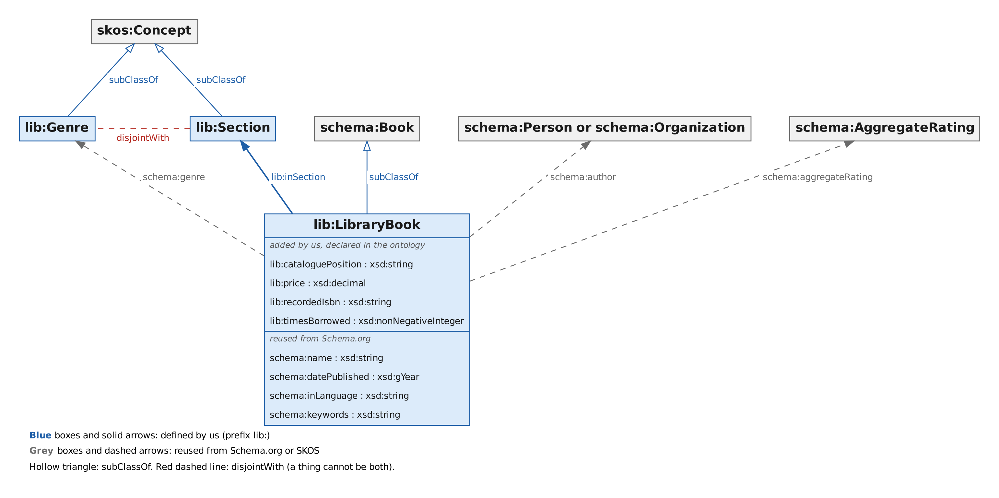
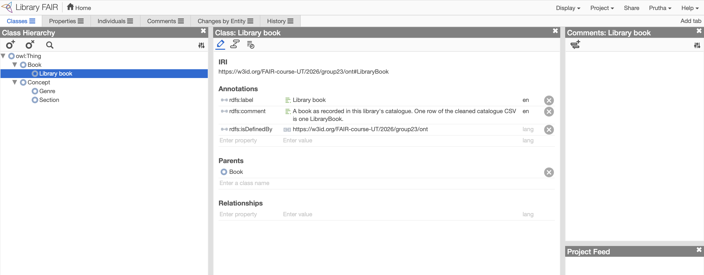
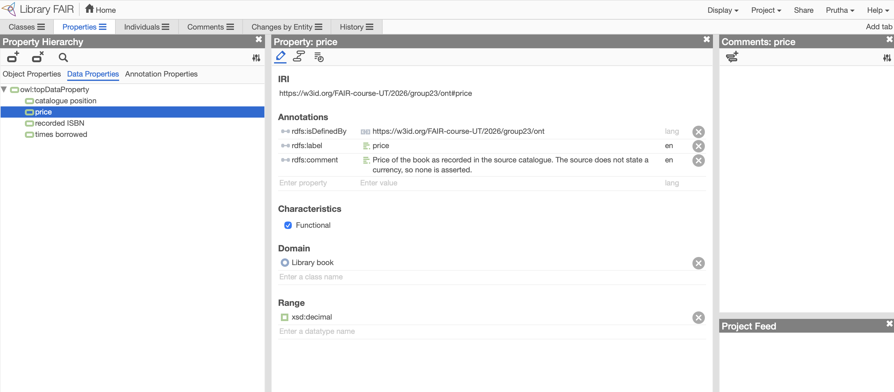
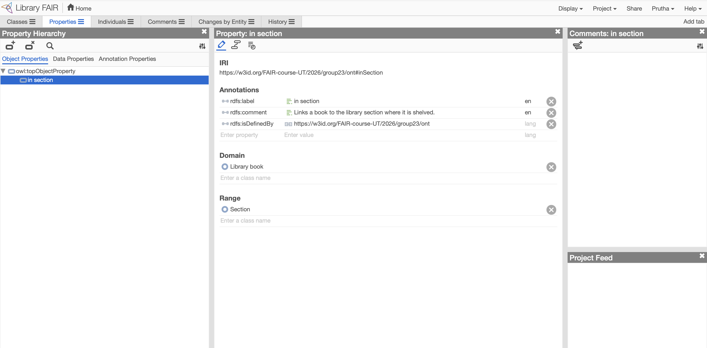

# Ontology, mapping decisions and RDF examples

Library Catalogue FAIRification, FAIR Data Engineering 2026-1A, University of Twente.
Authors: Prutha Vijaykumar Thakkar and Rattan Kumar. Version 0.1.0, 23 October 2026.
This document covers the semantic model and RDF part of the project (Person 2).

## 1. At a glance

- Source data: Kaggle "Library Catalog" (MIT licence), cleaned with OpenRefine and then repaired by `scripts/patch_csv.py`.
- Result: **2077 books**, described in **39,890 RDF triples** (`data/rdf/library.ttl`, Turtle).
- Vocabulary: Schema.org first, plus a small library ontology (`ontology/library-ontology.ttl`) with 3 classes and 5 properties.
- Links to other data: 1,912 of 2077 books (92.1%) point to their Open Library work with `schema:sameAs`, and 797 authors to their Open Library author record (section 7).
- Quality gate: SHACL shapes and 8 URI checks, all passing (see section 8).
- Namespaces:

| prefix | namespace | what lives there |
|---|---|---|
| `lib:` | `https://w3id.org/FAIR-course-UT/2026/group23/ont#` | our own classes and properties |
| `data:` | `https://w3id.org/FAIR-course-UT/2026/group23/data#` | books, authors, genres, sections |
| `schema:` | `https://schema.org/` | reused Schema.org terms |
| `skos:` | `http://www.w3.org/2004/02/skos/core#` | concepts and concept schemes |
| `xsd:` | `http://www.w3.org/2001/XMLSchema#` | datatypes |

## 2. The model in one picture



- One `schema:Book` (also typed `lib:LibraryBook`) per CSV row.
- A book points to its author (a shared `schema:Person` or `schema:Organization`), its genre (a `lib:Genre`) and its section (a `lib:Section`).
- Genres and sections are SKOS concepts in two concept schemes, so each label exists once and can be corrected in one place.
- Ratings sit in a small `schema:AggregateRating` node on the book.
- Blue means defined by us, grey means reused from Schema.org or SKOS. The diagram is generated from the ontology file by `scripts/draw_ontology.py`.

The ontology was also loaded into WebProtégé to check that identifiers, labels, comments, parents, domains and ranges read back correctly:







## 3. Ontology reference

Generated from `ontology/library-ontology.ttl`. Licence: CC BY 4.0. Identifier: `https://w3id.org/FAIR-course-UT/2026/group23/ont`.

### Classes

| term | label | subclass of | disjoint with | meaning |
|---|---|---|---|---|
| `lib:Genre` | Genre | `skos:Concept` |  | A literary genre label from the catalogue, for example Drama or Poetry. Modelled as a SKOS concept so spelling variants become visible and fixable in one place. |
| `lib:LibraryBook` | Library book | `schema:Book` |  | A book as recorded in this library's catalogue. One row of the cleaned catalogue CSV is one LibraryBook. |
| `lib:Section` | Section | `skos:Concept` | `lib:Genre` | An area of the library where books are shelved, for example Fiction or Children. Modelled as a SKOS concept so sections can be listed and reused. |

### Properties

| term | kind | domain | range | functional | meaning |
|---|---|---|---|---|---|
| `lib:cataloguePosition` | data | `lib:LibraryBook` | `xsd:string` | yes | The unique shelf-style code of a book in the catalogue, for example A1-B1-0001. This is the identifier we build every book URI from. |
| `lib:price` | data | `lib:LibraryBook` | `xsd:decimal` | yes | Price of the book as recorded in the source catalogue. The source does not state a currency, so none is asserted. |
| `lib:recordedIsbn` | data | `lib:LibraryBook` | `xsd:string` | yes | The ISBN text exactly as found in the source. The values have 12 digits, so they are not valid ISBN-13 numbers and must not be used for linking. |
| `lib:timesBorrowed` | data | `lib:LibraryBook` | `xsd:nonNegativeInteger` | yes | How many times the book has been borrowed, as recorded in the source catalogue. |
| `lib:inSection` | object | `lib:LibraryBook` | `lib:Section` | yes | Links a book to the library section where it is shelved. |

- "Functional" means a book has at most one value, so two prices for one book would be an error.
- Everything else (title, author, year, genre, language, keywords, rating) is reused from Schema.org and is not redefined.

## 4. Mapping: CSV column to RDF

"Filled" counts the rows where the cell is not blank. A blank cell produces no triple.

| CSV column | example | RDF | datatype or target | filled |
|---|---|---|---|---|
| `catalogue_position` | A1-B1-0001 | book IRI `data:book-A1-B1-0001` and `lib:cataloguePosition` | IRI and `xsd:string` | 2077 of 2077 |
| `title` | Enormous Room | `schema:name` | `xsd:string` | 2077 of 2077 |
| `author` | E. E. Cummings | `schema:author` | shared `schema:Person` or `schema:Organization` with `schema:name` | 2076 books linked (2077 cells, 1 is "Anonymous") |
| `year_published` | 1949 | `schema:datePublished` | `xsd:gYear` | 2072 of 2077 |
| `genre` | Drama | `schema:genre` | `lib:Genre` concept with `skos:prefLabel` | 2026 of 2077 |
| `section` | Fiction | `lib:inSection` | `lib:Section` concept with `skos:prefLabel` | 2019 of 2077 |
| `times_borrowed` | 3 | `lib:timesBorrowed` | `xsd:nonNegativeInteger` | 2071 of 2077 |
| `ratings` and `ratings_count` | 4.14 and 2 | `schema:aggregateRating` | node with `ratingValue`, `ratingCount`, `bestRating 5`, `worstRating 1` | 1759 of 2077 (count present for 1735) |
| `price` | 14.66 | `lib:price` | `xsd:decimal`, no currency | 1882 of 2077 |
| `language` | en | `schema:inLanguage` | `xsd:string` | 2075 of 2077 |
| `isbn` | 978-5-720-1389-0 | `lib:recordedIsbn` | `xsd:string` | 177 of 2077 |
| `subjects` | Fiction, war and military, ... | `schema:keywords` | one `xsd:string`, kept whole | 2027 of 2077 |

## 5. Mapping decisions and reasons

| # | decision | reason | FAIR |
|---|---|---|---|
| 1 | Reuse Schema.org for everything it covers, add `lib:` terms only where Schema.org has no fit (3 classes and 5 properties: position, loans, price, recorded ISBN, section) | Other tools already understand Schema.org, and fewer new terms means less to maintain | I1, I2 |
| 2 | Book IRI is `data#book-<catalogue position>` | The position is unique (2077 of 2077), stable and meaningful to the library | F1 |
| 3 | Hash IRIs (`data#...`) under the course prefix `https://w3id.org/FAIR-course-UT/2026/group23/` | The course sets the prefix: `.../ont` for the ontology and `.../data#` for the data, served through the course's W3ID relay. The part after `#` is never sent to a server, so one redirect for `/data` serves every record | F1, A1 |
| 4 | Authors, genres and sections are their own resources | One place to fix a spelling, one node linking many books, and a target for links to other datasets | I3 |
| 5 | Person or Organization is decided by name patterns and a short list of known organisations | The CSV has no type column. Result: 839 persons and 35 organisations (41 books have an organisation author) | limitation, see section 9 |
| 6 | "Anonymous" gets no author triple (1 book) | Avoids inventing a person called Anonymous | accuracy |
| 7 | " & " in an author cell creates two authors (1 book: A4-B4-0008) | Each person gets a node of their own | I3 |
| 8 | Years are `xsd:gYear`. Years later than 2026 are blanked by the patch step | Two impossible values were left by the OpenRefine step: A2-B3-0024 (2999) and A4-B3-0082 (2119) | R1 |
| 9 | A blank cell means no triple, never an empty string or a made-up value | Missing data stays visibly missing, and the table above shows how complete each property is | R1 |
| 10 | `isbn` is published as `lib:recordedIsbn`, not `schema:isbn` | All 177 values have 12 digits (for example 978-5-720-1389-0) and an ISBN-13 needs 13, so `schema:isbn` would claim a validity we cannot support | R1 |
| 11 | `lib:price` has no currency | The source does not state one | R1 |
| 12 | Rating scale is assumed to be 1 to 5 | Observed values range from 1.03 to 5.0, but the source does not state the scale | R1 |
| 13 | `subjects` stays one `schema:keywords` string | The separator (a comma) also occurs inside headings such as "Fiction, historical", so splitting would break terms | R1 |
| 14 | Genre and Section are separate classes declared disjoint | A shelf area and a literary genre are different things, and a reasoner can flag any mix-up | I1 |
| 15 | Triples are generated by a script, not by the OpenRefine RDF extension | One command reproduces the file exactly, it is version controlled and it is tested | R1.2 |
| 16 | Text repairs (broken accents) are logged cell by cell in `data/patch_log.csv` | Anyone can see what changed from the OpenRefine export: 771 subjects, 11 titles, 10 authors, 2 years | R1.2 |
| 17 | Licences: data MIT (as the source), ontology CC BY 4.0 | Proposed default, to be confirmed by both authors before publishing | R1.1 |
| 18 | The metadata has two distributions: the original CSV and the FAIRified RDF | The course asks for these two. The cleaned CSV stays in the repository as the input of the pipeline | F2, R1.2 |
| 19 | Books and authors are linked to Open Library with `schema:sameAs`, and only the identifier is stored | Open Library is a large open catalogue with stable public identifiers, and copying its data would create a second copy to maintain. `schema:sameAs` is widely understood; a stricter option for books is `schema:exampleOfWork`, which the group can choose instead | I3 |

## 6. RDF examples (real excerpts from `data/rdf/library.ttl`)

### 6.1 A complete book with its shared genre and section

```turtle
@prefix data: <https://w3id.org/FAIR-course-UT/2026/group23/data#> .
@prefix lib: <https://w3id.org/FAIR-course-UT/2026/group23/ont#> .
@prefix schema: <https://schema.org/> .
@prefix skos: <http://www.w3.org/2004/02/skos/core#> .
@prefix xsd: <http://www.w3.org/2001/XMLSchema#> .

data:book-A1-B1-0001 a schema:Book,
        lib:LibraryBook ;
    schema:aggregateRating [ a schema:AggregateRating ;
            schema:bestRating 5 ;
            schema:ratingCount 2 ;
            schema:ratingValue 4.14 ;
            schema:worstRating 1 ] ;
    schema:author data:author-e-e-cummings ;
    schema:datePublished "1949"^^xsd:gYear ;
    schema:genre data:genre-drama ;
    schema:inLanguage "en" ;
    schema:keywords "Fiction, biographical, American fiction (fictional works by one author), Fiction, war & ..." ;
    schema:name "Enormous Room" ;
    schema:sameAs <https://openlibrary.org/works/OL21077191W> ;
    lib:cataloguePosition "A1-B1-0001" ;
    lib:inSection data:section-fiction ;
    lib:price 14.66 ;
    lib:timesBorrowed "3"^^xsd:nonNegativeInteger .

data:author-e-e-cummings a schema:Person ;
    schema:name "E. E. Cummings" ;
    schema:sameAs <https://openlibrary.org/authors/OL7896048A> .

data:genre-drama a lib:Genre ;
    skos:inScheme data:scheme-genres ;
    skos:prefLabel "Drama"@en .

data:section-fiction a lib:Section ;
    skos:inScheme data:scheme-sections ;
    skos:prefLabel "Fiction"@en .
```

- The book, its genre and its section are three separate resources joined by IRIs.
- The rating is a blank node (it has no IRI of its own) because nobody needs to link to it.

### 6.2 A book whose author is an organisation

```turtle
data:book-A2-B2-0063 a schema:Book,
        lib:LibraryBook ;
    schema:author data:author-early-english-text-society ;
    schema:datePublished "1864"^^xsd:gYear ;
    schema:inLanguage "en" ;
    schema:name "[Publications]. Original series" ;
    schema:sameAs <https://openlibrary.org/works/OL245322W> ;
    lib:cataloguePosition "A2-B2-0063" ;
    lib:price 9.99 ;
    lib:timesBorrowed "1"^^xsd:nonNegativeInteger .

data:author-early-english-text-society a schema:Organization ;
    schema:name "Early English Text Society" ;
    schema:sameAs <https://openlibrary.org/authors/OL2555629A> .
```

- No genre, section, rating or keywords triples exist here because those cells were blank.

### 6.3 A book with two authors and a rating

```turtle
data:book-A4-B4-0008 a schema:Book,
        lib:LibraryBook ;
    schema:aggregateRating [ a schema:AggregateRating ;
            schema:bestRating 5 ;
            schema:ratingCount 1 ;
            schema:ratingValue 4.19 ;
            schema:worstRating 1 ] ;
    schema:author data:author-amanda-hendrix,
        data:author-charles-wohlforth ;
    schema:datePublished "2016"^^xsd:gYear ;
    schema:genre data:genre-science ;
    schema:inLanguage "en" ;
    schema:keywords "Manned space flight, Astronautics, Space flight, physiological effect" ;
    schema:name "Beyond Earth" ;
    schema:sameAs <https://openlibrary.org/works/OL25870328W> ;
    lib:cataloguePosition "A4-B4-0008" ;
    lib:inSection data:section-science ;
    lib:price 14.84 ;
    lib:timesBorrowed "2"^^xsd:nonNegativeInteger .

data:author-amanda-hendrix a schema:Person ;
    schema:name "Amanda Hendrix" .

data:author-charles-wohlforth a schema:Person ;
    schema:name "Charles Wohlforth" .
```

### 6.4 Queries that the model makes possible

Five authors with the most books:

```sparql
SELECT ?name (COUNT(?book) AS ?books) WHERE {
  ?book a lib:LibraryBook ; schema:author ?author .
  ?author schema:name ?name .
} GROUP BY ?name ORDER BY DESC(?books) ?name LIMIT 5
```

| author | books |
|---|---|
| Agatha Christie | 65 |
| William Shakespeare | 41 |
| Charles Dickens | 36 |
| Arthur Conan Doyle | 31 |
| John Buchan | 27 |

Average times borrowed per section:

```sparql
SELECT ?section (AVG(?loans) AS ?average_loans) WHERE {
  ?book lib:inSection ?s ; lib:timesBorrowed ?loans .
  ?s skos:prefLabel ?section .
} GROUP BY ?section ORDER BY DESC(?average_loans)
```

| section | average times borrowed |
|---|---|
| Young Adult | 203.5 |
| Non-Fiction | 100.9 |
| Fiction | 42.4 |
| Science | 35.4 |
| Children | 26.4 |
| Reference | 13.8 |
| History | 13.4 |
| Humanities | 3.9 |
| Rare Books | 0.0 |

## 7. Links to Open Library (linking points and example queries)

### 7.1 How the links were made

- `scripts/link_openlibrary.py` asks the Open Library search API about every book (title, and author when known) and ran on 23 October 2026.
- A hit is accepted only when the title is at least 90 percent similar **and** the author agrees (same surname, or a name at least 85 percent similar). Both must hold. When a book has no author, the title alone decides.
- Only identifiers are stored: `https://openlibrary.org/works/OL...W` for a book and `https://openlibrary.org/authors/OL...A` for an author. No Open Library text is copied.
- The answers are frozen in `data/openlibrary_links.csv`, so `build_rdf.py` gives the same RDF every time, even if the live service changes.
- The script puts a contact address in its User-Agent header and waits half a second between requests, as Open Library asks.
- An author is linked only when the book really has that author (not for "Anonymous", and not for books with two authors).

### 7.2 Results

| measure | value |
|---|---|
| books checked | 2077 |
| books linked | 1912 (92.1%) |
| no match | 165 |
| errors | 0 |
| authors linked | 763 persons and 34 organisations (806 links) |
| precision | 30 of 30 randomly chosen matches were correct (100.0%) when Person 2 checked them by hand on 24 October 2026. A match counts as correct when the Open Library page is the same book (same title and author, any edition). With only 30 checked matches the true precision could still be as low as about 89% (95% confidence, Wilson interval) |

Coverage per section (query B below):

| section | books | linked | share |
|---|---|---|---|
| Fiction | 1140 | 1077 | 94.5% |
| Children | 236 | 222 | 94.1% |
| Humanities | 229 | 210 | 91.7% |
| Non-Fiction | 215 | 172 | 80.0% |
| Young Adult | 68 | 66 | 97.1% |
| Reference | 52 | 48 | 92.3% |
| History | 39 | 37 | 94.9% |
| Science | 28 | 23 | 82.1% |
| Rare Books | 12 | 0 | 0.0% |

- 2019 of 2077 books have a section in the source, so the other 58 do not appear in this table.
- No book was matched in: Rare Books. The reason has not been investigated.
- 9 authors have two Open Library author records, because Open Library itself holds duplicates for them (for example George Orwell). Both links are kept, since both are the same person.
- 5 Open Library works are shared by two of our books (two catalogue entries for the same work).

### 7.3 Linking points

| our resource | property | target |
|---|---|---|
| book (`lib:LibraryBook`) | `schema:sameAs` | `https://openlibrary.org/works/OL...W` |
| author (`schema:Person` or `schema:Organization`) | `schema:sameAs` | `https://openlibrary.org/authors/OL...A` |

A real example of a linked book, its author and its link is in section 6.1.

### 7.4 Example queries

Query A, five linked books (runs on our data):

```sparql
SELECT ?pos ?title ?work WHERE {
  ?book a lib:LibraryBook ; lib:cataloguePosition ?pos ; schema:name ?title ; schema:sameAs ?work .
  FILTER(STRSTARTS(STR(?work), "https://openlibrary.org/works/"))
} ORDER BY ?pos LIMIT 5
```

| catalogue position | title | Open Library work |
|---|---|---|
| A1-B1-0001 | Enormous Room | https://openlibrary.org/works/OL21077191W |
| A1-B1-0002 | Plutarchi Vitae parallelae | https://openlibrary.org/works/OL723358W |
| A1-B1-0003 | The water-babies | https://openlibrary.org/works/OL1130038W |
| A1-B1-0004 | Kipps | https://openlibrary.org/works/OL52261W |
| A1-B1-0005 | Man and Superman | https://openlibrary.org/works/OL1066526W |

Query B, how many books of each section are linked:

```sparql
SELECT ?section (COUNT(DISTINCT ?book) AS ?books) (COUNT(DISTINCT ?linked) AS ?linkedBooks) WHERE {
  ?book a lib:LibraryBook ; lib:inSection ?s .
  ?s skos:prefLabel ?section .
  OPTIONAL { ?book schema:sameAs ?linked }
} GROUP BY ?section ORDER BY DESC(?books)
```

Results are in the table in section 7.2.

Query C, five authors with their Open Library record:

```sparql
SELECT ?name ?olAuthor WHERE {
  ?p a schema:Person ; schema:name ?name ; schema:sameAs ?olAuthor .
} ORDER BY ?name LIMIT 5
```

| author | Open Library author record |
|---|---|
| Charlie Roberts | https://openlibrary.org/authors/OL12988878A |
| A. A. Milne | https://openlibrary.org/authors/OL29881A |
| A. E. W. Mason | https://openlibrary.org/authors/OL37503A |
| A. Merritt | https://openlibrary.org/authors/OL769457A |
| A. Rushton | https://openlibrary.org/authors/OL422557A |

Using the other dataset: the link is followed over HTTP. For example `https://openlibrary.org/works/OL52261W.json` returns Open Library's own record for the work that our match chose for the book "Kipps". Queries that join our graph with Open Library's data in one step were not run. The course lists them as a bonus.

## 8. Validation

Command: `python scripts/validate.py --selftest | tee documentation/validation_log.txt`. The output of the last run is saved in `documentation/validation_log.txt`. A correct run ends with "All checks passed."

| check | what it proves |
|---|---|
| A | The ontology, the data, the three shapes, the example record and the three FAIR Data Point records in `metadata/` all parse as Turtle |
| B | Every book conforms to `shapes/book-shape.ttl` (one title, a position like A1-B1-0001, a year from 1000 to 2026, a non-negative price, a lowercase language code, authors that are resources, rating between 1 and 5) |
| C1 | Every subject IRI is in the `data#` namespace |
| C2 | No illegal characters in any IRI |
| C3 | No dangling references: every author, genre and section that is used is also described |
| C4 | Every `lib:` term used in the data is declared in the ontology |
| C5 | Catalogue positions are unique (2077 values) |
| C6 | Each book IRI is built from its own catalogue position |
| C7 | The number of books equals the number of CSV rows (2077 and 2077) |
| C8 | Every author node belongs to at least one book (no orphans) |
| D | The hand-written example record `shapes/test-fixtures/dataset-record-draft.ttl` conforms to the Dataset and Distribution shapes |
| F1 | FAIR Data Point dataset record: title, description, licence, publisher with a name, keywords, landing page, theme and language are present |
| F2 | Every contact point is a `mailto:` link |
| F3 | The dataset identifier is `https://w3id.org/FAIR-course-UT/2026/group23/dataset` (one clean link) |
| F4, F5 | The original CSV distribution and the RDF distribution each have a title and a licence, and their identifier, download URL and access URL are the W3ID links `.../distribution/original-csv` and `.../distribution/ttl` |
| F6 | The redirect rules in `w3id/` have a test for both distribution links |
| F7 | If an RDF distribution record states a byte size, it equals the real size of `data/rdf/library.ttl` (reported only when a size is stated) |
| WARN | Not failures. Lines for things the FAIR Data Point schemas still need: a media type stored as text instead of a link, `dcat:format` instead of `dcterms:format`, no `dcterms:source`, no byte size |
| E | Self-tests: broken books (year 2999, negative price, missing title, capital-letter language, plain-text author, bad position), broken example records for the shapes (no licence, no keywords, no media type, no download URL, media type as text), an author node without a book, and broken FAIR Data Point records (contact point without `mailto:`, an identifier that holds a long text, no licence, a download link that is not the W3ID link, the wrong identifier, a wrong byte size) must be rejected. A correct book and correct sample records must be accepted |

- The self-tests matter because a checker that never fails proves nothing: they show the checks can reject bad data.
- The ontology was viewed in WebProtégé but no reasoner was run on it.

## 9. Reproduce everything

From the repository root:

```
pip install -r requirements.txt
python scripts/patch_csv.py data/library_catalogue_clean.csv data/library_catalogue_repaired.csv data/patch_log.csv
python scripts/link_openlibrary.py data/library_catalogue_repaired.csv data/openlibrary_links.csv --email YOUR_EMAIL
python scripts/build_rdf.py data/library_catalogue_repaired.csv data/rdf/library.ttl --base https://w3id.org/FAIR-course-UT/2026/group23/ --links data/openlibrary_links.csv
python scripts/validate.py --selftest | tee documentation/validation_log.txt
python scripts/check_w3id_rules.py w3id/rules/FAIR-course-UT/2026/group23 --repo-root .
python scripts/draw_ontology.py ontology/library-ontology.ttl documentation/ontology-diagram
```

- The last command needs Graphviz (the `dot` program).
- Tested with Python 3.13, rdflib 7.6.0, pySHACL 0.40.1 and ftfy 6.3.1. `requirements.txt` asks for rdflib 7.0, pyshacl 0.26 and ftfy 6.1 or newer.
- The input is Person 1's OpenRefine export `data/library_catalogue_clean.csv`. Re-running the build gives byte-identical output. The first command (the Open Library search) is optional: `data/openlibrary_links.csv` is the saved result, and asking the live service again later may give different answers.

## 10. Known limitations and open items

- **W3ID rules are merged.** Pull request #33 to the course relay (`luizbonino/pid-relay`) was merged by the course bot on 23 October 2026 after one passing check. All nine addresses end with HTTP 200 after three hops (w3id.org, the course relay, GitHub). They redirect straight to the raw files, so there is no content negotiation: a browser and a program both receive the file. The rules and their tests are in `w3id/rules/FAIR-course-UT/2026/group23/`, and `scripts/check_w3id_rules.py` checks them locally.
- **Organisation detection is rule-based.** The 35 organisations the script printed should be reviewed by eye. A wrong guess changes only the type (`schema:Person` or `schema:Organization`) of one author node.
- **ISBN values are not usable for linking.** They have 12 digits, so they are kept as text only.
- **Prices:** 24 values are above 1000, 12 of them first editions in the Rare Books section (A7-B4). They are kept as in the source, and no currency is known.
- **Rating scale** is assumed, see decision 12.
- **Open Library links:** 1912 of 2077 books (92.1%) are linked. Precision: 30 of 30 randomly chosen matches were correct (100.0%) when Person 2 checked them by hand on 24 October 2026. A match counts as correct when the Open Library page is the same book (same title and author, any edition). With only 30 checked matches the true precision could still be as low as about 89% (95% confidence, Wilson interval). A hit needs title and author to agree, so a wrong match is possible, and the hand check measures how often.
- **FAIR Data Point records.** The three files in `metadata/` are exports made by Person 1. Their record IRIs start with `http://localhost:8080` (a local installation); the persistent W3ID links are in the identifier, download URL and access URL. `scripts/validate.py` checks them (F1 to F7) and prints WARN lines for what is still open: media type stored as text, `dcat:format` instead of `dcterms:format`, no source and no byte size.
- **Shapes and FAIR Data Point schemas are not aligned yet.** `shapes/dataset-shape.ttl` and `shapes/distribution-shape.ttl` were written before the FAIR Data Point existed. The FAIR Data Point keeps the identifier in a sub-record and links distributions through a container, so the shapes cannot be pasted into it unchanged. Editing the FAIR Data Point schemas and saving them in the repository is still open.

## 11. Related files

| path | purpose |
|---|---|
| `ontology/library-ontology.ttl` | the ontology (master copy) |
| `data/library_catalogue_original.csv` | the original Kaggle file (first distribution; Person 1) |
| `data/library_catalogue_clean.csv` | Person 1's OpenRefine export (input of the pipeline) |
| `data/library_catalogue_repaired.csv` | the export after the text repairs of `scripts/patch_csv.py` |
| `data/patch_log.csv` | every cell changed by the patch step |
| `data/rdf/library.ttl` | the catalogue as RDF, with the Open Library links |
| `data/openlibrary_links.csv` | the saved Open Library matches (one row per book) |
| `data/openlibrary_links_review_sample.csv` | 30 random matches for the check by hand |
| `shapes/book-shape.ttl`, `shapes/dataset-shape.ttl`, `shapes/distribution-shape.ttl` | SHACL shapes |
| `metadata/dataset-record.ttl`, `metadata/distribution-original-csv.ttl`, `metadata/distribution-rdf.ttl` | the three FAIR Data Point records (exports made by Person 1) |
| `shapes/test-fixtures/dataset-record-draft.ttl` | a hand-written example record, used by `validate.py` to test the shapes |
| `scripts/` | patch, build, validate, link, check and draw scripts |
| `w3id/rules/FAIR-course-UT/2026/group23/` and `w3id/README.md` | redirect rules and tests for the persistent identifiers, and the steps to submit them |
